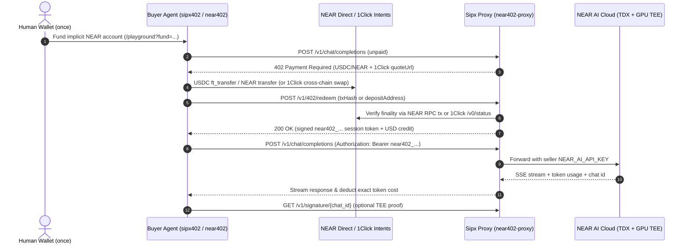

# Sipx (`sipx402` / `near402`)

**Minimal HTTP 402 pay-per-token private AI inference proxy for NEAR agents.**

No API keys. No buyer accounts. Agents pay HTTP `402 Payment Required` challenges once via NEAR or NEAR Intents 1Click and stream verifiable TEE inference from [NEAR AI Cloud](https://cloud.near.ai).

**[Live Playground](https://sipx-production.up.railway.app/playground)** · **[Live Proxy](https://sipx-production.up.railway.app/health)** · **[npm (`sipx402`)](https://www.npmjs.com/package/sipx402)**

---

## Architecture


<details>
<summary>Wire Flow (HTTP 402 → Settlement → Metered TEE Inference)</summary>



</details>

| Package            | Path                                   | Purpose                                                                      |
| ------------------ | -------------------------------------- | ---------------------------------------------------------------------------- |
| `@near402/protocol` | [`packages/protocol`](packages/protocol) | Shared `402` challenge, quote, redemption, token cost, and header helpers    |
| `near402-proxy`    | [`packages/proxy`](packages/proxy)     | Seller reverse proxy with dual-rail NEAR / 1Click verification & SSE metering |
| [`sipx402`](https://www.npmjs.com/package/sipx402) | [`packages/client`](packages/client) | Buyer SDK (`createNear402Fetch`), `sipx402/pi`, OpenAI bridge & `sipx402` CLI |
| Agent Skill        | [`skill/SKILL.md`](skill/SKILL.md)     | Pasteable skill for coding agents                                            |

---

## Try It in 30 Seconds

### 1. Buyer: CLI, Harness Bridge, or SDK

```bash
npm install -g sipx402                              # or prefix commands with npx sipx402
sipx402 use https://sipx-production.up.railway.app
sipx402 fund                                        # auto-inits wallet, claims $0.02 trial, checks NEAR gas
sipx402 chat "Explain NEAR Intents in 1 sentence"
```

**Any Agent Harness (`pi`, Codex, Cursor, Claude Code, Python):**

```bash
sipx402 serve --port 4021                           # OpenAI bridge at http://127.0.0.1:4021/v1
```

Set `OPENAI_BASE_URL=http://127.0.0.1:4021/v1` and `OPENAI_API_KEY=near402`. For Pi extensions, import `sipx402/pi` (`registerPiNear402`).

<details>
<summary>0-Gas USDC Protection (what happens if an agent holds USDC with 0 NEAR)</summary>

Funding an unactivated implicit account with only `USDC` normally fails on `ft_transfer` (`1 yoctoNEAR` + gas). The [Playground Funder](https://sipx-production.up.railway.app/playground?fund=) automatically bundles a `0.02 NEAR` gas starter, and `sipx402` raises `InsufficientGasError` before signing.

</details>

**OpenAI SDK + TEE Proof Verification:**

```ts
import OpenAI from "openai";
import { createNear402Fetch, verifyChatProof } from "sipx402";

const client = new OpenAI({
  baseURL: "https://sipx-production.up.railway.app/v1",
  apiKey: "near402",
  fetch: createNear402Fetch({
    accountId: process.env.NEAR_ACCOUNT_ID!,
    privateKey: process.env.NEAR_PRIVATE_KEY as `ed25519:${string}`,
    preferredAsset: "auto", // uses USDC if funded + gas ready, else NEAR
  }),
});

const res = await client.chat.completions.create({
  model: "Qwen/Qwen3-VL-30B-A3B-Instruct",
  messages: [{ role: "user", content: "Hello private TEE world!" }],
});
console.log(res.choices[0].message.content);
```

Verify hardware TEE signatures via `verifyChatProof(...)` (see [`examples/demo-agent.ts`](examples/demo-agent.ts)) or click **Verify TEE Signature** in the [Playground](https://sipx-production.up.railway.app/playground).

---

### 2. Seller: Run the Proxy

**Docker:**

```bash
docker run -p 4020:4020 \
  -e NEAR_AI_API_KEY="your-near-ai-cloud-key" \
  -e SELLER_ACCOUNT_ID="you.near" \
  -e SESSION_SECRET="$(openssl rand -hex 32)" \
  -e FREE_ALLOWANCE_USD="0.02" \
  ghcr.io/ikwuoz/near402-proxy:latest
```

**Docker Compose:**

```bash
cp .env.example .env && docker compose up -d --build
```

**Local Node 24:**

```bash
cp .env.example .env && npm install && npm run build && npm run proxy
```

Default model: `Qwen/Qwen3-VL-30B-A3B-Instruct` ($0.15 / 1M input, $0.55 / 1M output + `MARKUP_BPS` margin).

---

## Security & Spend Controls

| Control              | Purpose                                                        |
| -------------------- | -------------------------------------------------------------- |
| **Encrypted Wallet** | `AES-256-GCM` + `scrypt` (`~/.near402/wallet.json`)            |
| **NEAR Gas Keys**    | Scoped, revocable agent keys with capped gas & nonce lanes     |
| **Spend Guardrails** | Pre-sign per-tx, rolling `1h` / `24h`, lifetime & allowlists   |

```bash
sipx402 init --encrypt                                                  # encrypted wallet
sipx402 key provision --owner you.near --owner-key ed25519:... --save   # isolated Gas Key
sipx402 key status                                                      # inspect key / nonces
sipx402 spend                                                           # inspect 1h / 24h / total USD
```

---

## Protocol Endpoints

| Method | Path                      | Description                                                      |
| ------ | ------------------------- | ---------------------------------------------------------------- |
| `GET`  | `/health`                 | Service status, seller account, default model, and pricing       |
| `GET`  | `/playground`             | Interactive 402 playground & `?fund=<accountId>` wallet funder   |
| `GET`  | `/v1/models`              | Available NEAR AI Cloud models with `near402_pricing`            |
| `POST` | `/v1/chat/completions`    | OpenAI-compatible chat completions (`402` if unpaid)             |
| `POST` | `/v1/responses`           | OpenAI Responses API pass-through behind `402`                   |
| `POST` | `/v1/embeddings`          | Embeddings pass-through behind `402`                             |
| `POST` | `/v1/402/quote`           | NEAR Intents 1Click cross-chain deposit quote (`depositAddress`) |
| `POST` | `/v1/402/redeem`          | Verify `near_direct` or `near_intents` payment & issue token     |
| `GET`  | `/v1/402/balance`         | Remaining USD credit for the active `near402_...` token          |
| `POST` | `/v1/402/trial`           | Claim IP-limited free trial credit (`FREE_ALLOWANCE_USD > 0`)    |
| `GET`  | `/v1/attestation/report`  | NEAR AI Cloud TEE hardware attestation                           |
| `GET`  | `/v1/signature/:chatId`   | NEAR AI Cloud TEE chat signature                                 |

Single-shot payments also work via `X-402-Payment: near_direct:<txHash>:<senderAccountId>`.

---

## Development

```bash
npm install && npm run typecheck && npm test
```
