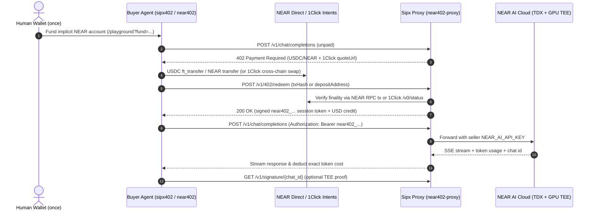

# Sipx (`sipx402` / `near402`)

**Minimal HTTP 402 pay-per-token private AI inference proxy for NEAR agents.**

No API keys. No buyer accounts. An agent hits an OpenAI-compatible endpoint, receives `402 Payment Required` with NEAR & NEAR Intents 1Click payment instructions, pays once, gets a signed `near402_...` session token, and streams verifiable TEE inference from [NEAR AI Cloud](https://cloud.near.ai).

**[Live Playground](https://sipx-production.up.railway.app/playground)** · **[Live Proxy (`https://sipx-production.up.railway.app`)](https://sipx-production.up.railway.app/health)** · **[npm (`sipx402`)](https://www.npmjs.com/package/sipx402)**

---

## Try It in 30 Seconds

### 1. Buyer: CLI, Universal Harness Bridge, or SDK

```bash
npm install -g sipx402
near402 use https://sipx-production.up.railway.app
near402 fund                                        # auto-inits wallet, claims $0.02 trial, checks NEAR gas
near402 chat "Explain NEAR Intents in 1 sentence"
```

*(No global install? Prefix commands with `npx -p sipx402 near402 ...`.)*

**Any Agent Harness (`pi`, Codex, Cursor, Claude Code, Python):**

```bash
near402 serve --port 4021                           # starts local bridge at http://127.0.0.1:4021/v1
```

Point any OpenAI-compatible harness at `OPENAI_BASE_URL=http://127.0.0.1:4021/v1` and `OPENAI_API_KEY=near402`. For Pi extension hosts, import `sipx402/pi` (`registerPiNear402`) for `/fund`, `/spend`, and `near402_chat`.

> **0-Gas USDC Protection:** Funding an unactivated implicit account with only `USDC` normally fails on `ft_transfer` (`1 yoctoNEAR` + gas). The [Live Playground Funder](https://sipx-production.up.railway.app/playground?fund=) automatically bundles a `0.02 NEAR` gas starter, and `sipx402` raises `InsufficientGasError` before signing.

**OpenAI SDK + TEE Proof Verification:**

```ts
import OpenAI from "openai";
import { createNear402Fetch, verifyChatProof } from "sipx402";

const client = new OpenAI({
  baseURL: "https://sipx-production.up.railway.app/v1",
  apiKey: "near402",
  fetch: createNear402Fetch({
    accountId: process.env.NEAR_ACCOUNT_ID!,
    privateKey: process.env.NEAR_PRIVATE_KEY as `ed25519:${string}`,
    preferredAsset: "auto", // uses USDC if funded + gas ready, otherwise NEAR
  }),
});

const res = await client.chat.completions.create({
  model: "Qwen/Qwen3-VL-30B-A3B-Instruct",
  messages: [{ role: "user", content: "Hello private TEE world!" }],
});
console.log(res.choices[0].message.content);
```

Verify hardware TEE provenance (`GET /v1/attestation/report` + `/v1/signature/{chat_id}`) via `verifyChatProof(...)` (see [`examples/demo-agent.ts`](examples/demo-agent.ts)) or click **Verify TEE Signature** in the [Playground](https://sipx-production.up.railway.app/playground).

---

### 2. Seller: Run Your Own Proxy

| Mode | Command |
|---|---|
| **Docker (pre-built)** | `docker run -p 4020:4020 -e NEAR_AI_API_KEY="..." -e SELLER_ACCOUNT_ID="you.near" -e SESSION_SECRET="$(openssl rand -hex 32)" -e FREE_ALLOWANCE_USD="0.02" ghcr.io/ikwuoz/near402-proxy:latest` |
| **Docker Compose** | `cp .env.example .env && docker compose up -d --build` |
| **Local Node 24** | `cp .env.example .env && npm install && npm run build && npm run proxy` |

Default model is `Qwen/Qwen3-VL-30B-A3B-Instruct` ($0.15/1M input, $0.55/1M output base + configurable `MARKUP_BPS` margin), synced with `https://cloud-api.near.ai/v1/models`.

---

## Architecture


<details>
<summary>Wire Flow (HTTP 402 → Settlement → Metered TEE Inference)</summary>



</details>

### Packages

| Package | Path | Purpose |
|---|---|---|
| `@near402/protocol` | [`packages/protocol`](packages/protocol) | Shared `402` challenge, quote, redemption, token cost, and header helpers |
| `near402-proxy` | [`packages/proxy`](packages/proxy) | Seller reverse proxy (Aperture + Lightmeter style) with dual-rail NEAR/1Click verification & SSE metering |
| [`sipx402`](https://www.npmjs.com/package/sipx402) | [`packages/client`](packages/client) | Buyer SDK (`createNear402Fetch`), `sipx402/pi` extension, local OpenAI bridge, and `near402` CLI |
| Agent Skill | [`skill/SKILL.md`](skill/SKILL.md) | Zero-config pasteable skill for coding agents |

---

## Security & Spend Controls

| Control | Capability | CLI / SDK Usage |
|---|---|---|
| **Encrypted Wallet** | `AES-256-GCM` + `scrypt` keystore (`~/.near402/wallet.json`); public metadata readable locked | `near402 init --encrypt` · `near402 wallet encrypt` · `NEAR402_WALLET_PASSPHRASE` |
| **Scoped / Gas Keys** | Isolated NEAR Gas Key (`gas_key_full`, `gas_key_function_call`, or `function_call`) with capped gas & nonce lanes | `near402 key provision --owner you.near --owner-key ed25519:... --mode gas_key_full --save --encrypt` · `near402 key status` · `near402 key revoke` |
| **Spend Guardrails** | Pre-sign per-tx, rolling `1h` / `24h`, lifetime, origin & recipient allowlists | `spendPolicy` in `createNear402Fetch` · `--max-per-payment` / `--max-daily` · `near402 spend` |

---

## Protocol Endpoints

| Method | Path | Description |
|---|---|---|
| `GET` | `/health` | Service status, seller account, default model, and pricing |
| `GET` | `/playground` | Interactive `@hot-labs/near-connect` 402 playground & `?fund=<accountId>` wallet funder |
| `GET` | `/v1/models` | Available NEAR AI Cloud models with `near402_pricing` |
| `POST` | `/v1/chat/completions` | OpenAI-compatible chat completions (streaming & non-streaming); `402` if unpaid |
| `POST` | `/v1/responses` | OpenAI Responses API pass-through behind `402` |
| `POST` | `/v1/embeddings` | Embeddings pass-through behind `402` |
| `POST` | `/v1/402/quote` | Generate a NEAR Intents 1Click cross-chain deposit quote (`depositAddress`) |
| `POST` | `/v1/402/redeem` | Verify payment (`near_direct` txHash or `near_intents` depositAddress) & issue `near402_...` token |
| `GET` | `/v1/402/balance` | Check remaining USD credit for the active `near402_...` token |
| `POST` | `/v1/402/trial` | Claim one-time IP-limited free trial credit when `FREE_ALLOWANCE_USD > 0` |
| `GET` | `/v1/attestation/report` | Free pass-through to NEAR AI Cloud TEE hardware attestation |
| `GET` | `/v1/signature/:chatId` | Free pass-through to NEAR AI Cloud TEE chat signature |

Single-shot payments are also supported via `X-402-Payment: near_direct:<txHash>:<senderAccountId>`.

---

## Development & Tests

```bash
npm install
npm run typecheck
npm test
```
