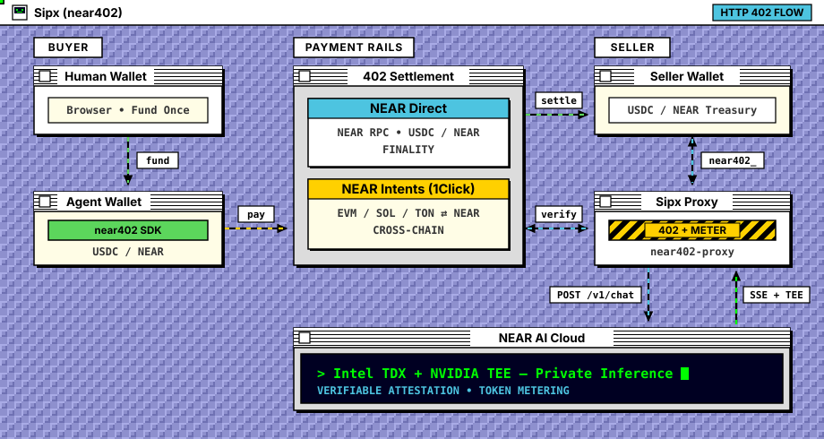
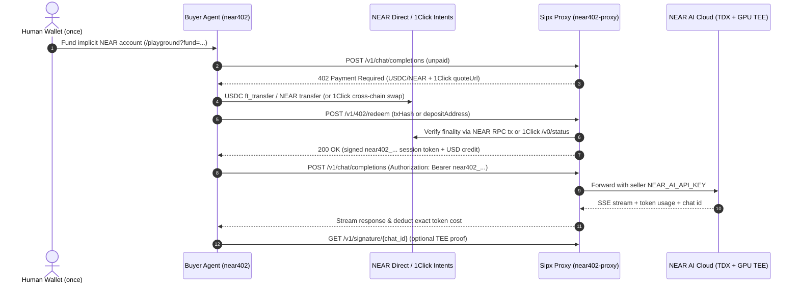

# Sipx (`near402`)

**Minimal HTTP 402 pay-per-token private AI inference proxy for NEAR agents.**

No API keys. No buyer accounts. An agent hits any OpenAI-compatible endpoint, receives `402 Payment Required` with NEAR & NEAR Intents 1Click payment instructions, pays once, gets a signed `near402_...` session token, and streams verifiable TEE inference from [NEAR AI Cloud](https://cloud.near.ai) until its credit is spent.

---

## Architecture



<details>
<summary>Wire Flow (HTTP 402 → Settlement → Metered TEE Inference)</summary>



</details>

### Packages

| Package | Path | Purpose |
|---|---|---|
| `@near402/protocol` | [`packages/protocol`](packages/protocol) | Shared 402 challenge, quote, redemption, token cost, and header helpers |
| `near402-proxy` | [`packages/proxy`](packages/proxy) | Seller reverse proxy (Aperture + Lightmeter) with dual-rail NEAR/1Click verification & SSE usage metering |
| `near402` | [`packages/client`](packages/client) | Buyer SDK (`createNear402Fetch`), NEAR wallet manager, and `near402` CLI |
| `near402` Skill | [`skill/SKILL.md`](skill/SKILL.md) | Zero-config pasteable agent skill |

---

## Try It in 30 Seconds

### 1. Seller: Run the Proxy (Docker, Compose, or Node 24)

**Pre-built image / Docker (one command):**

```bash
docker run -p 4020:4020 \
  -e NEAR_AI_API_KEY="your-near-ai-cloud-key" \
  -e SELLER_ACCOUNT_ID="your-seller.near" \
  -e SESSION_SECRET="$(openssl rand -hex 32)" \
  -e FREE_ALLOWANCE_USD="0.02" \
  ghcr.io/near402/near402-proxy:latest
```

Or build locally with Docker Compose:

```bash
cp .env.example .env
# Add NEAR_AI_API_KEY and SELLER_ACCOUNT_ID to .env
docker compose up -d --build
```

**Local Node 24:**

```bash
cp .env.example .env
# Add NEAR_AI_API_KEY and SELLER_ACCOUNT_ID to .env
npm install
npm run build
npm run proxy
```

Default model is `Qwen/Qwen3-VL-30B-A3B-Instruct` ($0.15/1M input, $0.55/1M output base + configurable `MARKUP_BPS` seller margin), with live pricing synced from `https://cloud-api.near.ai/v1/models`.

### 2. Buyer: Zero-Config Agent CLI, Universal OpenAI Bridge & SDK

**1-Command CLI / Free Trial / Agent Harness Bridge:**

```bash
npx near402 use http://localhost:4020                 # save active Sipx proxy URL
npx near402 fund                                    # auto-creates wallet, claims free trial if available, checks NEAR gas + USDC
npx near402 serve --port 4021                       # local OpenAI bridge for pi, Codex, Cursor, Claude Code, Python
npx near402 chat "Explain NEAR Intents in 1 sentence"
```

Any OpenAI-compatible harness (`pi`, Codex CLI, Cursor, Python `openai`) can point at `OPENAI_BASE_URL=http://127.0.0.1:4021/v1` with `OPENAI_API_KEY=near402` — the bridge automatically handles `402` settlement, free-trial claim (`POST /v1/402/trial`), session caching, and spend caps. For Pi extension hosts, import `near402/pi` (`registerPiNear402`) to add `/fund`, `/spend`, and `near402_chat`.

> **Note on the "USDC with 0 NEAR gas" trap:** `/playground?fund=<accountId>` automatically bundles a `0.02 NEAR` gas starter when funding an unactivated implicit account with `USDC`, and `near402` raises `InsufficientGasError` before attempting an `ft_transfer` without gas.

**Drop-in with the official OpenAI SDK + TEE Proof Verification:**

```ts
import OpenAI from "openai";
import { createNear402Fetch, verifyChatProof } from "near402";

const client = new OpenAI({
  baseURL: "http://localhost:4020/v1",
  apiKey: "near402",
  fetch: createNear402Fetch({
    accountId: process.env.NEAR_ACCOUNT_ID!,
    privateKey: process.env.NEAR_PRIVATE_KEY as `ed25519:${string}`,
    preferredAsset: "auto", // uses USDC if funded, otherwise native NEAR
  }),
});

const res = await client.chat.completions.create({
  model: "Qwen/Qwen3-VL-30B-A3B-Instruct",
  messages: [{ role: "user", content: "Hello private TEE world!" }],
});
console.log(res.choices[0].message.content);
```

To cryptographically verify the NEAR AI Cloud hardware TEE signature (SHA-256 request/response hashes + EIP-191 ECDSA recovery against `/v1/attestation/report`), call `verifyChatProof({ proxyBaseUrl, chatId, model, requestBody, responseBody })` (see [`examples/demo-agent.ts`](examples/demo-agent.ts)) or click **Verify TEE Signature** inside `/playground`.

### 3. Production Security & Spend Controls

- **Encrypted Agent Wallet (`AES-256-GCM` + `scrypt`):**
  ```bash
  near402 init --encrypt        # creates encrypted ~/.near402/wallet.json
  near402 wallet encrypt        # encrypt an existing plaintext wallet in-place
  ```
  Pass `--passphrase` or set `NEAR402_WALLET_PASSPHRASE` when running `near402 chat`; `near402 balance` and `near402 key status` read public metadata without unlocking the key.
- **Scoped / NEAR Gas Keys:** Provision an isolated Gas Key (`gas_key_full` for USDC `ft_transfer` + capped gas + multi-nonce lanes, or `function_call` / `gas_key_function_call` scoped to a contract/methods) and revoke anytime:
  ```bash
  near402 key provision --owner your.near --owner-key ed25519:... --mode gas_key_full --gas-deposit 0.05 --nonces 4 --save --encrypt
  near402 key status
  near402 key revoke --owner your.near --owner-key ed25519:... --public-key ed25519:...
  ```
- **Client-Side Spend Guardrails:** Enforce per-payment, rolling 1h/24h, lifetime, origin, and seller-recipient allowlists before signing any transaction via `spendPolicy` in `createNear402Fetch` (or `--max-per-payment` / `--max-hourly` / `--max-daily` in CLI, inspectable via `near402 spend`).

---

## Protocol Endpoints

| Method | Path | Description |
|---|---|---|
| `GET` | `/health` | Service status, seller account, default model, and pricing |
| `GET` | `/playground` | Zero-build `@hot-labs/near-connect` interactive 402 playground & `?fund=<accountId>` agent wallet funder |
| `GET` | `/v1/models` | Available NEAR AI Cloud models with `near402_pricing` |
| `POST` | `/v1/chat/completions` | OpenAI-compatible chat completions (streaming & non-streaming); returns `402` if unpaid |
| `POST` | `/v1/responses` | OpenAI Responses API pass-through behind `402` |
| `POST` | `/v1/embeddings` | Embeddings pass-through behind `402` |
| `POST` | `/v1/402/quote` | Generate a NEAR Intents 1Click cross-chain deposit quote (`depositAddress`) |
| `POST` | `/v1/402/redeem` | Verify payment (`near_direct` txHash or `near_intents` depositAddress) and issue/top-up `near402_...` token |
| `GET` | `/v1/402/balance` | Check remaining USD credit for the active `near402_...` token |
| `POST` | `/v1/402/trial` | Claim one-time IP-limited free trial credit when `FREE_ALLOWANCE_USD > 0` |
| `GET` | `/v1/attestation/report` | Free pass-through to NEAR AI Cloud TEE hardware attestation |
| `GET` | `/v1/signature/:chatId` | Free pass-through to NEAR AI Cloud TEE chat signature |

Single-shot payments are also supported directly via `X-402-Payment: near_direct:<txHash>:<senderAccountId>`.

---

## Development & Tests

```bash
npm install
npm run build
npm test
```

